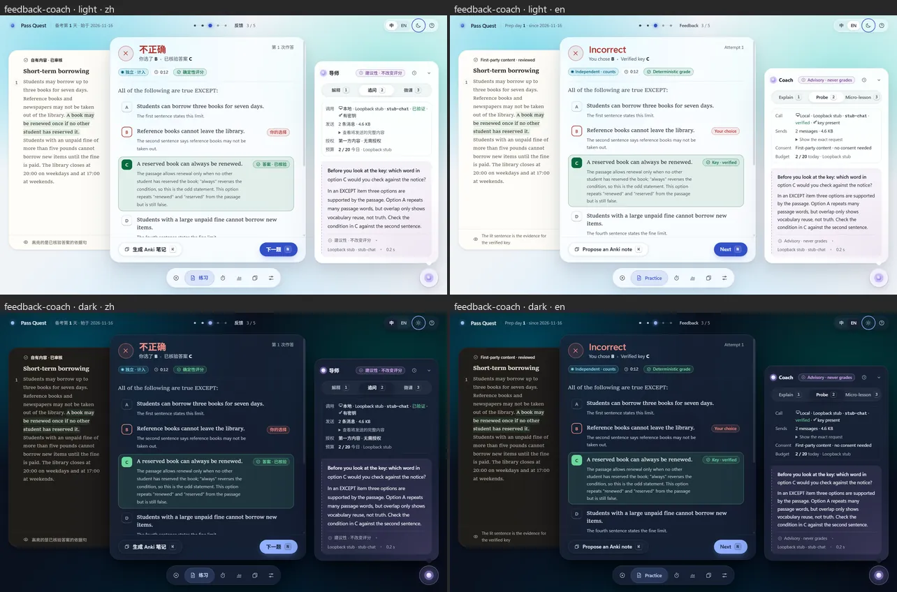

# Pass Quest — local-first AI exam coach for passing a written English exam

**English** | [简体中文](README.zh-CN.md)

[](https://github.com/wxxb789/passquest/releases/latest)
[](https://github.com/wxxb789/passquest/actions/workflows/gate.yml)


[](LICENSE)

**Pass Quest is a free, open-source, local-first desktop exam coach.** It helps an adult learner with
limited English pass one specific **written English exam** (reading comprehension, cloze, vocabulary
in context) within a short preparation window. It does not try to teach general English.

It picks the next exercise from your own recorded attempts, teaches **test-taking tactics** such as
NOT/EXCEPT questions and evidence location, and grades each answer deterministically against a verified
key. Optional **bring-your-own-key AI coaching** (OpenAI, Qwen, Doubao, DeepSeek, Gemini or any
OpenAI-compatible endpoint) explains answers, and it turns mistakes into **Anki flashcards**. Timed
assessments on unseen questions show your **independent exam readiness**. Your study data stays on
your computer.



## Download

**[Download the latest release →](https://github.com/wxxb789/passquest/releases/latest)**

| Platform | Package | Needs |
|---|---|---|
| Windows 11+ x64 | `pass-quest-setup-<version>-amd64.exe`: per-user installer, no admin rights | Microsoft Edge WebView2 Runtime (ships with Windows 11) |
| macOS 26 and 27 on Apple silicon | `pass-quest-<version>-arm64.dmg` | none |
| Linux x86_64 (second-tier) | `Pass_Quest-<version>-x86_64.AppImage` | GTK 3 and WebKitGTK 4.1 |

Each package bundles its own Node runtime and agent hosts, so you do not need to install any developer
tools. The installers are **unsigned**: Windows SmartScreen and macOS Gatekeeper will warn on first
launch. The [install guide](docs/install.md) ([Chinese](docs/install.zh-CN.md)) explains how to get
past the warning on each platform, where your data lives, how to upgrade and how to uninstall; on
macOS, `brew install --cask wxxb789/tap/pass-quest` installs the same package and skips the warning.
**Settings → Updates** checks this
repository's GitHub Releases only when you click it. It never downloads or installs anything by itself.

## Why Pass Quest

- **Built to pass the exam.** Progress means questions answered correctly on your own, per hour of
  study. Words learned, cards made and minutes spent do not count as progress.
- **Honest evidence.** Every attempt is marked as independent or assisted, and as first or repeated
  exposure. A hint or a walkthrough marks the attempt assisted, and assisted attempts never count as
  transfer.
- **No invented numbers.** The pass threshold is unknown, so Pass Quest shows accuracy, timing and
  failure modes. It never shows a made-up "chance of passing".
- **The AI advises; it does not grade.** Model output is labelled advisory. It cannot change a grade,
  an answer key or your attempt history.
- **Local-first and private.** Study history lives in a local SQLite database. Private source text
  stays on your computer until you preview it and record consent. API keys are kept in the OS
  credential store or an environment variable, never in the repository.
- **Works offline.** Practice, feedback, review, recommendations and reports run with no network,
  no LLM and no Anki.

## Features

| Feature | What you get | Details |
|---|---|---|
| Verified practice | Exam-style reading questions, deterministic grading, the evidence sentence and an explanation | [evidence](docs/evidence/0001-first-independent-exam-attempt.md) |
| Import your own material | Page-linked import of TXT and PDF text layers. Native, OCR and scanned pages are labelled differently, and answers are used only after review | [source import](docs/source-import.md) |
| Scoring tactics | Guided, then independent NOT/EXCEPT practice that explains why keyword matching and "pick the longest answer" fail | [tactics](docs/tactics.md) |
| Adaptive next exercise | A transparent policy (`explain` / `practice_new` / `review`) whose reason names the counts it used | [adaptive](docs/adaptive.md) |
| BYOK AI tutor | Explanations, misconception probes and micro-lessons from your own model. You see the exact request before it is sent | [tutor](docs/tutor.md) |
| Provider and model choice | A registry of OpenAI, Qwen, Doubao, DeepSeek, Gemini and custom endpoints, with capability tests, per-provider daily budgets and failover only to a provider with the same consent scope | [providers](docs/providers.md) |
| Resumable study brief | A multi-step agent task on Pi Durable that you can pause, resume and cancel without creating duplicate steps | [agent](docs/agent.md) |
| Anki flashcards | One concise note per mistake or mark, pushed through a local AnkiConnect connection or exported as HTML/TSV, with a check that each card landed in the right deck | [notes](docs/notes.md) |
| Find practice | A capped search started only by a real gap in your results. Licences and sources are recorded, and fetched text is treated as data, never as instructions | [find](docs/find.md) |
| Unseen timed assessment | A holdout pool split by passage, a timed unassisted run, and a report that accounts for contaminated items and compares only like with like | [assess](docs/assess.md) |
| Desktop app | Today, practice, feedback, coach, assessment, Anki and settings in Chinese or English, with light and dark themes | [desktop](docs/desktop.md) |

## Command-line quick start

The headless CLI uses the same Go core as the desktop app. Practice needs only Go 1.27.
[mise](https://mise.jdx.dev/) installs the pinned toolchain from `mise.toml`.

```bash
git clone https://github.com/wxxb789/passquest.git && cd passquest
go run ./cmd/passquest practice      # answer a self-authored reading exercise
go run ./cmd/passquest report        # attempts by first/repeat and assisted/independent
go run ./cmd/passquest next          # the recommended next action and the reason for it
```

More commands:

```bash
passquest import --path DIR          # import private TXT/PDF text locally; nothing is uploaded
passquest tactic practice not-except-polarity --stage guided
passquest model use deepseek/deepseek-chat && passquest model test deepseek/deepseek-chat
passquest tutor ask --attempt 1      # advisory coaching; key read from PASSQUEST_TUTOR_API_KEY
passquest agent start                # resumable study brief (needs `bun install`)
passquest note propose --attempt 1 && passquest note push   # Anki via AnkiConnect
passquest assess start --size 40 --minutes 60 --annotations none
```

Build the desktop app from source:

```bash
bun install
bun run desktop:build
build/desktop/passquest-desktop
```

## How it works

Pass Quest follows one study loop: **Observe → Diagnose → Select → Coach → Attempt independently →
Verify → Adapt.** The Go core owns all study data (attempts, answer keys, assessments and notes) in
SQLite. A MyGo desktop window and the CLI are two front ends on that same core. Narrow Node hosts make
the outbound calls (model, search, AnkiConnect) and run the
[Pi Durable](https://github.com/earendil-works/pi) agent. They cannot change scores or the stored history. See
[Core design](docs/core-design.md) and [Conventions](docs/conventions.md).

## Project status

The current release is **v0.15.0**. Goals 0001–0015 are done, from headless practice to the packaged
desktop app with an update check. Every goal is merged only after one mechanical gate passes on
Windows, macOS and Linux (`bun run gate`, see [Harness](docs/harness.md)). The numbered roadmap is in
[docs/goals](docs/goals/README.md), and open owner decisions are in
[OPEN-QUESTIONS](docs/decisions/OPEN-QUESTIONS.md).

Not claimed: Intel macOS, Windows arm64 and Linux arm64 builds; code signing; any pass probability.

## FAQ

**Is Pass Quest a general English learning app?** No. It optimizes for passing one written exam with
limited time, so it teaches tactics plus only the English those tactics need. The exam has no
listening or speaking section.

**Do I need an AI API key?** No. Practice, grading, recommendations, reports, assessments and Anki
export all work without one. A key enables optional coaching only.

**Does it replace Anki?** No. Pass Quest writes notes into your Anki. Anki owns the cards and their
review schedule.

**Does my data leave my computer?** Only when you choose: a coach call to the provider you configured,
a search you start, or the update check you click. Private source text needs recorded consent first.

## Contributing

Agents and humans start from [AGENTS.md](AGENTS.md). Read [cross-platform rules](docs/cross-platform.md)
before adding paths or shell calls. `bun install && bun run gate` runs locally the same gate CI runs on every pull request.
[Releasing](docs/release.md) describes how version tags become draft releases.

## License

Pass Quest's code and documentation are released under the [MIT License](LICENSE). The licence does
**not** cover the material under `data/baselines/`: that text comes from a third-party document marked
internal-only, and this repository grants no right to use or redistribute it (see below).

## Confidential baseline material

The original 165-page CRSC preparation PDF states *仅限内部使用，严禁外传* ("internal use only, do
not distribute"). At the project owner's explicit direction, two **unreviewed** text extractions are
in this repository:

- [`data/baselines/2025-crsc-english-partial.txt`](data/baselines/2025-crsc-english-partial.txt):
  the earlier 22-page native-text extraction, kept as history.
- [`data/baselines/2026-crsc-english/`](data/baselines/2026-crsc-english/README.md): the page-linked
  parsed text of all 165 pages (22 native-text pages plus 143 OCR pages), authorised by the owner on
  2026-11-10. Its `README.md` records the parse method, the per-page provenance in `manifest.tsv`, and
  the visibility boundary.

This repository is **public**, even though the app is meant for internal use, so both extractions are
publicly accessible. Extracted text, OCR and answer keys have not been verified. Publication is not
evidence of redistribution rights. The original PDF stays at `data/private/source/` (gitignored). No
further OCR or new source material is published automatically, and no text may be uploaded to an
external provider without a new recorded decision. Tests must use independently written or clearly
licensed fixtures, never this material. The import feature stores source text only in the local
gitignored database and marks every imported page as unreviewed.

No API keys or personal study history belong in this repository.
