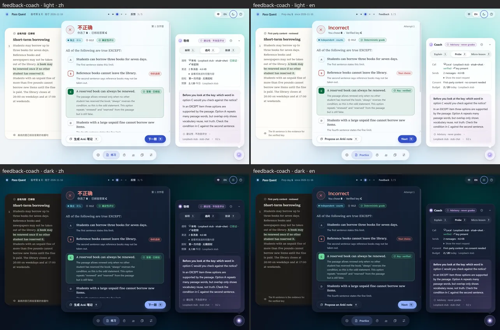

# Pass Quest：本地优先的 AI 应试教练，帮你通过英语笔试

[English](README.md) | **简体中文**

[](https://github.com/wxxb789/passquest/releases/latest)
[](https://github.com/wxxb789/passquest/actions/workflows/gate.yml)


[](LICENSE)

**Pass Quest 是一款免费、开源、本地优先的桌面应试教练。** 它帮助英语基础薄弱的成年考生，在有限的备考时间内通过某一场特定的**英语笔试**（阅读理解、完形填空、语境词汇，例如职称外语考试）。它不打算教通用英语。

它根据你自己的答题记录挑选下一道练习，教授 NOT/EXCEPT 否定题、定位原文证据等**应试技巧**，并按已核验的答案确定性地判分。可选的 **BYOK（自带密钥）AI 辅导**支持 OpenAI、通义千问 Qwen、豆包 Doubao、DeepSeek、Gemini 以及任意 OpenAI 兼容端点，用来讲解答案；错题还能生成 **Anki 卡片**。在从未见过的题目上做限时测评，能看出你的**独立应试水平**。学习数据只保存在你自己的电脑上。



## 下载

**[下载最新版本 →](https://github.com/wxxb789/passquest/releases/latest)**

| 平台 | 安装包 | 依赖 |
|---|---|---|
| Windows 11+ x64 | `pass-quest-setup-<version>-amd64.exe`：按用户安装，无需管理员权限 | Microsoft Edge WebView2 Runtime（Windows 11 自带） |
| macOS 26 与 27（Apple 芯片） | `pass-quest-<version>-arm64.dmg` | 无 |
| Linux x86_64（第二梯队） | `Pass_Quest-<version>-x86_64.AppImage` | GTK 3 与 WebKitGTK 4.1 |

每个安装包都自带 Node 运行时和 agent host，无需安装任何开发工具。安装包**未签名**，首次启动时 Windows SmartScreen 和 macOS Gatekeeper 会弹出警告。[安装指南](docs/install.zh-CN.md)（[English](docs/install.md)）说明了各平台如何放行、数据存放位置、如何升级与卸载；macOS 上用 `brew install --cask wxxb789/tap/pass-quest` 安装同一个包，不会遇到警告。**Settings → Updates** 只在你点击时检查本仓库的 GitHub Releases，从不自动下载或安装任何东西。

## 为什么选择 Pass Quest

- **为通过考试而设计。** 进步的衡量标准是每小时学习换来多少道独立答对的题。背了多少单词、做了多少卡片、学了多少分钟，都不算进步。
- **证据如实记录。** 每次作答都标明是独立还是有辅助、是首次还是重复接触。看过提示或引导讲解的作答记为有辅助，有辅助的作答永远不计入迁移。
- **不编造数字。** 及格线未知，所以 Pass Quest 只展示正确率、用时和错误类型，从不给出凭空捏造的"通过概率"。
- **AI 只提建议，不判分。** 模型输出标注为"建议性"，无法修改分数、答案或你的作答历史。
- **本地优先，保护隐私。** 学习记录存放在本地 SQLite 数据库中。私有资料原文在你预览并记录授权之前不会离开电脑。API 密钥保存在系统凭据库或环境变量中，绝不进入仓库。
- **可离线使用。** 练习、反馈、复习、推荐和报告都不需要联网，也不需要 LLM 或 Anki。

## 功能

| 功能 | 你能得到什么 | 详情 |
|---|---|---|
| 已核验练习 | 考试风格的阅读题、确定性判分、原文证据句和讲解 | [evidence](docs/evidence/0001-first-independent-exam-attempt.md) |
| 导入自己的资料 | 按页导入 TXT 和 PDF 文本层。原生文本页、OCR 页和扫描页分别标注，答案经审核后才会使用 | [source import](docs/source-import.md) |
| 得分技巧 | 先引导、后独立的 NOT/EXCEPT 练习，并解释为什么关键词匹配和"选最长的"不可靠 | [tactics](docs/tactics.md) |
| 自适应推荐 | 透明的推荐策略（`explain` / `practice_new` / `review`），给出的理由会写明所依据的计数 | [adaptive](docs/adaptive.md) |
| BYOK AI 导师 | 用你自己的模型讲解答案、探查误解、讲微课。发送前可以看到完整请求 | [tutor](docs/tutor.md) |
| 选择服务商与模型 | 内置 OpenAI、Qwen、Doubao、DeepSeek、Gemini 和自定义端点，提供能力测试、按服务商计算的每日预算，并且只会切换到授权范围相同的服务商 | [providers](docs/providers.md) |
| 可恢复的学习简报 | 基于 Pi Durable 的多步 agent 任务，可暂停、恢复、取消，不会产生重复步骤 | [agent](docs/agent.md) |
| Anki 卡片 | 每道错题或标记生成一张简洁笔记，通过本地 AnkiConnect 推送或导出为 HTML/TSV，并检查卡片是否进入了正确的牌组 | [notes](docs/notes.md) |
| 按需找题 | 只有成绩中出现真实短板时才会发起有上限的搜索。来源和许可证都有记录，抓取到的文本只当作数据，不当作指令 | [find](docs/find.md) |
| 未见题限时测评 | 按篇章划分的留出题池、限时无辅助作答，报告会考虑题目污染，并且只比较条件相同的测评 | [assess](docs/assess.md) |
| 桌面应用 | 今日、练习、反馈、导师、测评、Anki 和设置，支持中英文界面与浅色/深色主题 | [desktop](docs/desktop.md) |

## 命令行快速上手

无界面 CLI 与桌面应用共用同一个 Go 核心，练习只需要 Go 1.27。[mise](https://mise.jdx.dev/) 会按 `mise.toml` 安装锁定版本的工具链。

```bash
git clone https://github.com/wxxb789/passquest.git && cd passquest
go run ./cmd/passquest practice      # 做一道自编的阅读练习
go run ./cmd/passquest report        # 按首次/重复、有辅助/独立统计作答
go run ./cmd/passquest next          # 推荐的下一步及理由
```

更多命令：

```bash
passquest import --path DIR          # 在本地导入私有 TXT/PDF 文本，不上传任何内容
passquest tactic practice not-except-polarity --stage guided
passquest model use deepseek/deepseek-chat && passquest model test deepseek/deepseek-chat
passquest tutor ask --attempt 1      # 建议性辅导；密钥从 PASSQUEST_TUTOR_API_KEY 读取
passquest agent start                # 可恢复的学习简报（需要先 `bun install`）
passquest note propose --attempt 1 && passquest note push   # 通过 AnkiConnect 推送到 Anki
passquest assess start --size 40 --minutes 60 --annotations none
```

从源码构建桌面应用：

```bash
bun install
bun run desktop:build
build/desktop/passquest-desktop
```

## 工作原理

Pass Quest 遵循同一个学习循环：**观察 → 诊断 → 选择 → 辅导 → 独立作答 → 验证 → 调整。** Go 核心用 SQLite 保存全部学习数据（作答、答案、测评和笔记）。MyGo 桌面窗口和 CLI 是这同一个核心的两个前端。几个职责单一的 Node host 负责对外调用（模型、搜索、AnkiConnect）并运行 [Pi Durable](https://github.com/earendil-works/pi) agent，它们无法修改分数或已保存的历史。详见[核心设计](docs/core-design.md)与[约定](docs/conventions.md)。

## 项目状态

当前版本为 **v0.15.0**。目标 0001–0015 已全部完成，从无界面练习一直到带更新检查的桌面安装包。每个目标都要在 Windows、macOS 和 Linux 上通过同一套自动化门禁（`bun run gate`，见 [Harness](docs/harness.md)）后才能合并。编号路线图见 [docs/goals](docs/goals/README.md)，待项目所有者决定的问题见 [OPEN-QUESTIONS](docs/decisions/OPEN-QUESTIONS.md)。

尚未支持：Intel macOS、Windows arm64 和 Linux arm64 安装包；代码签名；任何形式的通过概率。

## 常见问题

**Pass Quest 是通用英语学习软件吗？** 不是。它的目标是在有限时间内通过一场笔试，所以只教应试技巧，以及运用这些技巧所需的英语。该考试没有听力和口语部分。

**一定要有 AI API 密钥吗？** 不需要。练习、判分、推荐、报告、测评和 Anki 导出都不依赖密钥，密钥只用于可选的 AI 辅导。

**它会取代 Anki 吗？** 不会。Pass Quest 把笔记写入你的 Anki，卡片和复习计划仍由 Anki 管理。

**我的数据会离开电脑吗？** 只在你主动操作时才会：向你配置的服务商发起辅导请求、发起一次搜索，或点击检查更新。私有资料原文必须先记录授权。

## 参与贡献

无论是 agent 还是人类，都请从 [AGENTS.md](AGENTS.md) 开始。新增路径或 shell 调用前请先阅读[跨平台规则](docs/cross-platform.md)。`bun install && bun run gate` 在本地运行与 CI 对每个 pull request 运行的同一套门禁。[发布流程](docs/release.md)说明了版本 tag 如何生成草稿 release。

## 许可证

Pass Quest 的代码和文档以 [MIT 许可证](LICENSE)发布。该许可证**不**覆盖 `data/baselines/` 下的资料：这些文本来自标注"仅限内部使用"的第三方文档，本仓库不授予任何使用或再分发它的权利（见下文）。

## 保密基线资料

165 页 CRSC（中国通号）备考 PDF 原件标注有"仅限内部使用，严禁外传"。应项目所有者的明确要求，本仓库包含两份**未经审核**的文本提取：

- [`data/baselines/2025-crsc-english-partial.txt`](data/baselines/2025-crsc-english-partial.txt)：早期的 22 页原生文本提取，作为历史保留。
- [`data/baselines/2026-crsc-english/`](data/baselines/2026-crsc-english/README.md)：全部 165 页按页解析的文本（22 页原生文本加 143 页 OCR），由所有者于 2026-11-10 授权。其 `README.md` 记录了解析方法、`manifest.tsv` 中的逐页来源，以及可见性边界。

尽管应用本身面向内部使用，本仓库是**公开**的，因此这两份提取文本都可被公开访问。提取文本、OCR 结果和答案均未经核验。公开发布并不证明拥有再分发权。PDF 原件保存在 `data/private/source/`（已加入 gitignore）。不会自动发布更多 OCR 或新的资料，未经新的书面决定，任何文本都不得上传给外部服务商。测试必须使用独立编写或许可明确的测试数据，绝不能使用这份资料。导入功能只把原文存入本地、已被 gitignore 的数据库，并把每个导入页标记为未审核。

本仓库不存放任何 API 密钥或个人学习记录。
